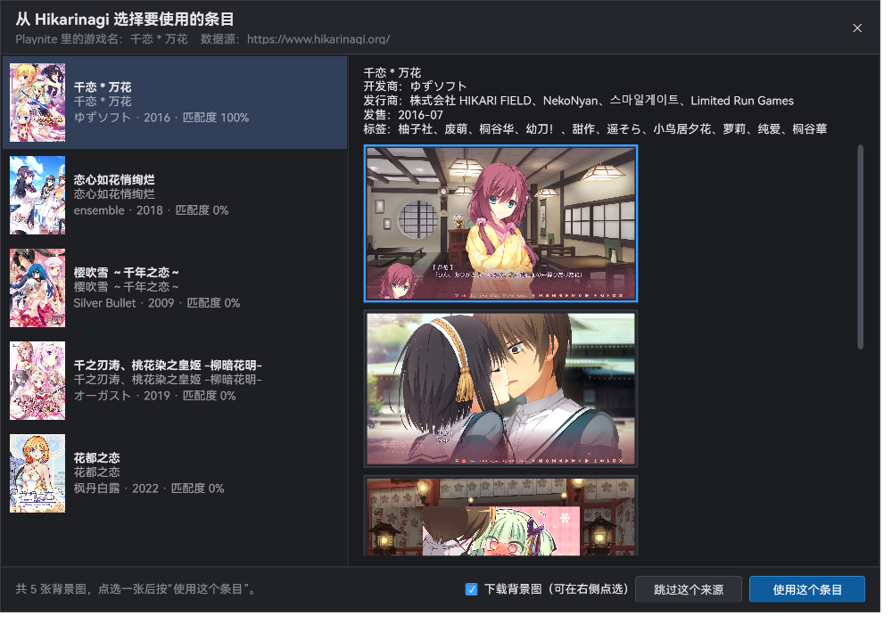
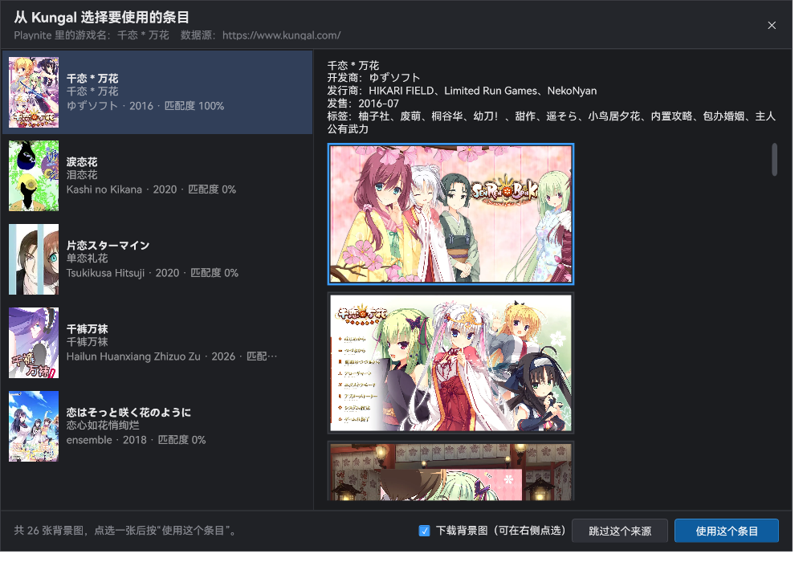

<b>简体中文</b> | <a href="./README.en.md">English</a>

# Galgame 资料数据来源插件（Playnite Metadata Provider ×5）

为 Playnite 新增 5 个「资料数据来源」插件，分别从下列目前 **没有 Playnite 插件** 的站点抓取元数据：

| 插件 | 网站 | 插件 ID | 安装目录 | DLL |
| --- | --- | --- | --- | --- |
| Ymgal Metadata Provider | https://www.ymgal.games/ | `YmgalMetadata_2460c7c5-5f79-4ebe-826d-cba2084e2464` | 同名文件夹 | `YmgalMetadata.dll` |
| Kungal Metadata Provider | https://www.kungal.com/ | `KungalMetadata_664139ab-88b1-4be5-869e-592b81e21df6` | 同名文件夹 | `KungalMetadata.dll` |
| Hikarinagi Metadata Provider | https://www.hikarinagi.org/ | `HikarinagiMetadata_57db3d17-7ad1-4f98-83b3-bcffb08ef8d2` | 同名文件夹 | `HikarinagiMetadata.dll` |
| Shionlib Metadata Provider | https://shionlib.com/ | `ShionlibMetadata_e882fba8-217a-4fcd-a400-b53b3392a734` | 同名文件夹 | `ShionlibMetadata.dll` |
| TouchGAL Metadata Provider | https://www.touchgal.ink/ | `TouchgalMetadata_af145bc3-1883-4933-a1d7-d5124de2cccd` | 同名文件夹 | `TouchgalMetadata.dll` |

- 目标框架：.NET Framework 4.6.2（与 Playnite 10.51 一致），不依赖任何第三方 DLL，5 个插件各自独立、可单独启用/停用。
- 当前版本 **v0.6**。已在 Playnite 10.51.0.23209 上实测：5 个插件同时加载无报错，四个免 Token 的站点刮削正常，TouchGAL 需自备 API 令牌。图标取自各站点自己的网站图标；设置界面与「手动选择」窗口为暗色主题，**支持中文 / English 切换**。

## 安装

**方式一：用 .pext 安装包（推荐）**

1. 打开 `releases\` 目录，下载 5 个 `.pext` 文件（或者只需要其中几个）。
2. Playnite → 主菜单 → **附加组件** → **安装附加组件** → 选择 `.pext` 文件。
3. 重启 Playnite，在 **设置 → 元数据** 的「来源」列表里就能看到这 5 个来源。

**方式二：手动复制**

把 `dist\<插件名>_<Guid>\` 整个文件夹复制到 `%APPDATA%\Playnite\Extensions\`，重启 Playnite。

> 覆盖安装前请先完全退出 Playnite，否则 DLL 被占用会复制失败。

**方式三：一键脚本（从源码目录直接升级）**

先退出正在玩的游戏，然后双击 `tools\install-and-restart.cmd`：它会关闭 Playnite、把 `dist\` 里最新的 5 个插件复制进扩展目录、再重新启动 Playnite。

## 在 Playnite 里怎么用

1. 选中要刮削的游戏 → 右键 → **编辑…** → **元数据** 选项卡 → **下载元数据**。
2. 在元数据窗口的 **来源** 列表里勾选这 5 个来源（Ymgal / Kungal / Hikarinagi / Shionlib / TouchGAL），选择要下载的字段后确定。
3. 每个来源会弹出一个 **选择窗口**：左边选是哪一个条目，右边从该站点的全部背景图里点选一张（默认选中第一张），点「使用这个条目」确认；不想用这个来源就点「跳过这个来源」。
4. 也可以在 **设置 → 元数据** 里把它们设为默认使用的来源。

插件会把结果按字段交给 Playnite：名称、类型（Genres）、发售日、开发商、发行商、标签、简介、链接、社区评分、封面、背景、年龄分级、平台、特性。

## 手动选择匹配结果与背景图

这是仿 VNDB Nexus 的交互，默认开启（设置里的「每次刮削时手动确认匹配结果并选择背景图」）：

- **窗口外观**：暗色主题（`#1B1C1F` 底色、自绘标题栏、可拖动/可缩放），1000×700，不影响 Playnite 自身主题。

| Hikarinagi（banner + 截图） | Kungal（banner + 整组 CG，共 26 张） |
| --- | --- |
|  |  |

- **左侧候选列表**：显示该站点按游戏名搜到的全部结果（封面缩略图、标题、副标题、开发商/年份、与你游戏名的匹配度）。匹配度最高的那个会预先选中。
- **右侧背景图**：选中左栏条目后，插件会去取该条目的详情，并把 **全部背景图**（banner + 所有截图，通常 1920×1080）以缩略图铺开。点任意一张即选中（蓝色加粗边框），Playnite 的「背景图片」字段就会用这张；取消勾选「下载背景图」则不下载背景，只取文字和封面。
  - 各站背景图数量：Kungal 最多（`include=screenshots` 会带回整组 CG，例如《千恋＊万花》25 张）、Hikarinagi 与 Shionlib 为 5 张左右、TouchGAL 用 banner、Ymgal 没有截图（背景为空）。
  - 注意：Playnite 的「下载元数据」对话框里要 **勾选「背景图片」字段**，否则它根本不会向插件索取背景图，你选的这张也就不会写入。
- **跳过这个来源**：本次刮削该来源不提供任何数据（不会报错、不会乱填）。
- 如果你已经在游戏的「链接」里放了该站点的页面地址，插件会**按 ID 精确命中，并把该条目排在候选首位自动选中**，但窗口依旧会弹出，方便你核对后再确认（v0.4 起；旧版是命中链接就直接跳过弹窗）。
- 后台批量下载（Playnite 的「后台下载元数据」）不会弹窗，走的仍是自动匹配。
- **描述文字换行**：站点简介里的换行会被转成 HTML 的 ` ` 再交给 Playnite（Playnite 的描述框按 HTML 渲染，纯换行符会被折叠成一整段）。因此描述在 Playnite 里是正常分段的；如果你在编辑框里看到 ` ` 标签，那是字段的存储形式，显示时会变成换行。

## 插件设置（设置 → 扩展 → 选择插件 → 设置）

| 设置 | 默认 | 说明 |
| --- | --- | --- |
| 界面语言 | 中文 | 插件界面（设置页、选择窗口、提示）用中文还是 English，切换后立即生效 |
| 标题语言 | 有中文时用中文 | 有中文标题时用中文，否则用原名；选「使用原标题」则始终用原名 |
| 简介语言 | 有中文时用中文 | 同上，用于简介 |
| 在搜索结果中包含成人（R18）作品 | 开 | Kungal 必须开启才能搜到 R18 作品（否则结果会被过滤） |
| 下载封面图片 | 开 | 插件会先把图片下载到内存再交给 Playnite（避免防盗链），失败则回退为给 Playnite 一个 URL |
| 下载背景图片 | 开 | 有 banner/截图的站点会返回 1920×1080 的图；手动选择窗口里可再挑具体哪一张 |
| 每次刮削时手动确认匹配结果并选择背景图 | 开 | 关闭后回到全自动匹配（不再弹窗） |
| 最大标签数量（0 = 不限制） | 15 | 0 = 不限 |
| 没有精确匹配时接受最相近的结果 | 关 | 关闭时，匹配度过低会报错而不是乱填；打开后直接取搜索第一条 |

## 匹配规则与技巧

- 默认用 **游戏名** 在该站搜索，先用相似度（中/日文按字符二元组、兼顾包含关系）挑选最佳结果作为预选项；如果分数不够高，会拿前 3 个候选的详情页核对全部标题（原名/中文名/别名），确认一致才使用，仍然对不上就报错，不会乱填。
- 打开「手动确认匹配结果」后，上面这套自动匹配只用来决定窗口里预先选中哪一条，最终由你点「使用这个条目」确认。
- **推荐**：先把该游戏的站点页面链接加到 Playnite 游戏的 **链接** 里，之后刮削会按 ID 精确命中并把该条目预选在候选首位，不会串号（窗口仍会弹出让你确认）：

| 站点 | 可粘贴的链接格式 |
| --- | --- |
| Ymgal | `https://www.ymgal.games/ga22374` |
| Kungal | `https://www.kungal.com/galgame/15` |
| Hikarinagi | `https://www.hikarinagi.org/galgames/780` |
| Shionlib | `https://shionlib.com/zh/game/708` |
| TouchGAL | `https://www.touchgal.com/galgame/<8位 uniqueId>` |

- 搜索失败/无法确定匹配时，Playnite 右下角会弹出错误提示（后台批量更新时不弹，只写日志）。

## TouchGAL 的特别说明

TouchGAL 的网页/网页 API 受 Cloudflare 挑战保护，普通 HTTP 请求会被 403 拦截（实测 curl、带 cookie 的请求、headless 浏览器都不行），因此本插件改用其 **官方开发者 API**：`https://developer.touchgal.com/api/v1`。

需要你自己的 API Token：

1. 浏览器打开 <https://developer.touchgal.com>，注册/登录后创建 Token。
2. 在 Playnite：**设置 → 扩展 → TouchGAL Metadata Provider → 设置**，把 Token 粘贴到「TouchGAL API 令牌」输入框，保存。

没有 Token 时，该来源会提示这段说明而不会静默失败；其他 4 个来源完全不需要账号。

**TouchGAL 无截图、无 PV**：官方接口对每个游戏只返回一张 AVIF 竖版封面（771×1080），插件把它用作封面、背景留空；网站上的「游戏截图」与「PV鉴赏」位于 Cloudflare 保护的接口之后，插件无法获取。这张封面是 AVIF 格式，Windows 需要安装免费的「AV1 视频扩展」（Microsoft Store）才能显示；没有该扩展时插件会跳过这张图，而不是显示空白框。

## 各站字段覆盖情况

| 字段 | Ymgal | Kungal | Hikarinagi | Shionlib | TouchGAL |
| --- | --- | --- | --- | --- | --- |
| 中文标题 | ✅ | ✅ | ✅ | ✅ | ✅ |
| 简介（中文） | ✅ | ✅ | ✅ | ✅ | ✅ |
| 开发商 | ✅ | ✅ | ✅ | ✅ | ✅ |
| 发行商 | ✅ | ✅ | ✅ | ❌ | ✅ |
| 标签 | ✅（STAFF 里的署名，只取人名） | ✅ | ✅ | ✅ | ✅ |
| 评分 | ❌ | ✅（多站加权） | ❌（无聚合分） | ❌ | ✅ |
| 封面 | ✅ | ✅ | ✅ | ✅（R18 封面需开“包含成人作品”） | ✅ |
| 背景/截图 | ❌ | ✅ banner + 整组 CG（25 张左右） | ✅ 截图 | ✅ 截图 | ✅ banner |
| 年龄分级 | ✅（R18 标记） | ✅ | ✅（用封面/R18 标签推断） | 部分 | ✅ |
| 平台 | ✅（releases） | ✅ | ✅ | ✅ | ✅ |
| 额外链接 | 官网/Steam 等 | VNDB/Bangumi/Steam/DLsite/EGS 等 | 官网/Steam/VNDB/Bangumi 等 | VNDB/Bangumi/Hikarinagi + 官网商店 | 官网 |

所有站点的「标签」都会过滤掉无意义标签（`Galgame`、`PC`、`ADV`、`R18`、`汉化`、纯年份、厂商名、职员/声优名等），链接最多保留 12 条并按「本站 → VNDB → Bangumi → Steam → 官网 → 商店」排序去重。

## 已知限制

- **Ymgal**：标签取自站点「STAFF」卡片里脚本、原画、人物设计、音乐、歌曲的署名，只保留人名、不带到职位；站点本身没有作品标签、社区评分和截图/背景图，只有一张主封面；发行商取自站点的「发行商」条目，个别作品为空。
- **Kungal**：搜索必须打开「在搜索结果中包含成人（R18）作品」，否则 R18 作品会被站点过滤掉；标签里偶尔会混入厂商中文名或译名。
- **Hikarinagi**：不提供聚合评分，「社区评分」字段留空；年龄分级靠封面标记与 R18 标签推断，个别作品可能不准。
- **Shionlib**：没有发行商和评分；游客身份拿到的 R18 封面是模糊版，需要在设置里开启「包含成人作品」才会取原图。
- **TouchGAL**：必须自备 API Token 才能使用；只提供 banner 一张背景图；重装插件后需要在设置里再确认一次 Token。
- **匹配靠标题**：游戏名与站点标题差异大时（全英文名、罗马字、副标题过长）可能匹配失败或串到别的条目。最稳的做法是把站点页面地址加进游戏的「链接」，插件会按 ID 精确命中（窗口仍会弹出让你确认）。
- **多来源 = 多个窗口**：一次勾选 N 个来源，就会依次弹出 N 个窗口，需要逐个确认或跳过。
- **后台更新不弹窗**：Playnite 的后台下载元数据走全自动匹配，准确度不如手动确认；整库补全时建议逐个手动刮削。
- **速度**：每站限速 0.25–0.85 秒一次请求，一部游戏通常 1–3 秒；开启图片下载后更慢，整库刮削需要较长时间。
- **接口可能变更**：五个站点用的都是非官方或半公开接口，站点改版后插件可能需要更新版本才能继续使用。

## 贡献

欢迎 Issue / PR。数据源接口若发生变化，改动集中在对应站点的 `src\<站点>\<站点>Source.cs`，`tools\harness\Harness.exe` 可以在不启动 Playnite 的情况下直接验证。

## 致谢

本项目的全部元数据都来自下列站点通过**公开 API / 公开页面**提供的数据。**特别感谢这些平台开放公共 API、数据与资源**——没有它们，这个插件无从谈起。

| 站点 | 说明 |
| --- | --- |
| [Ymgal 月幕 Galgame](https://www.ymgal.games/) | 中文 Galgame 资料库，开放 `/open/archive` 查询接口 |
| [Kungal 鲲 Galgame](https://www.kungal.com/) | Galgame 社区与资料库 |
| [Hikarinagi](https://www.hikarinagi.org/) | 你和同好的 ACGN 社区 |
| [Shionlib 书音的图书馆](https://shionlib.com/) | Galgame 资料归档站 |
| [TouchGAL](https://www.touchgal.com/) | 一站式 Galgame 文化社区，提供官方 developer API |

Kungal 来源的结构化数据实际由 [NextMoe Catalog API](https://api.nextmoe.dev/) 提供，同样感谢其开放的公共接口；各站点数据中的交叉引用也一并致谢：

- [VNDB](https://vndb.org/) — The Visual Novel Database
- [Bangumi 番组计划](https://bangumi.tv/) — Bangumi
- [ErogameScape](https://erogamescape.dyndns.org/) — エロゲー批評空間
- [Steam](https://store.steampowered.com/) — 全球最大的数字游戏发行平台

本项目的接口字段、抓取策略与实现思路参考了以下开源项目，向作者们致谢：

- [ReinaManager](https://github.com/huoshen80/ReinaManager)
- [LunaBox](https://github.com/Saramanda9988/LunaBox)
- [NekoBox](https://github.com/doudou0611/NekoBox)

如果上述站点或项目认为本项目的使用方式有不妥之处，欢迎通过 Issue 联系，我们会及时调整或移除相关代码。

## 免责声明

- 本项目仅做公开信息的读取与格式化，不存储、不索引站点内容，也不绕过任何访问限制；抓取频率均做了限速（每站 0.25–0.85 秒一次）。
- 各站点数据的版权归原站点及权利人所有，请自行确认使用范围；商业用途请先取得站点授权。
- 与 Playnite 官方及上述任何站点均无隶属关系。

## 许可证

MIT，见 [LICENSE](LICENSE)。
